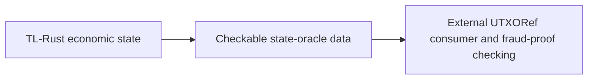

# TL state-oracle producer and external consumer

The user clarified the integration boundary on 26 October 2026:

UTXORef is a separate repository and runtime. TL produces the data on which
its external fraud-proof checks operate. Building the external proof engine is
not a TL-Rust completion requirement. TL does not use Binohash. An optional
Binohash feature belongs in UTXORef, where the user separately authorized it;
there is no Binohash export, dependency, fixture or default runtime path in this
crate. The old experimental Binohash inventory row remains an external
reference, excluded from TL module parity counts.

The existing `state_oracle` functions preserve the pinned legacy query and
serialization semantics. Their source-compatible balance projections alone
do not provide complete economic state or chain context. The implemented
[`EconomicStateOracleExport`](ECONOMIC_STATE_ORACLE.md) now produces **TLSEv1**
from the actual healthy, locked `DurableEconomicChain`, with independently
expected configuration and freshness head. It binds canonical full TLECv1–v6
owner bytes, network, pinned genesis, exact tip, rollback floor and separate
state/checkpoint/export commitments. One full TLEH checkpoint carries the
borrowed TLEC payload and the witness needed to check its relationship to the
independently expected durable head. Exact binary amounts avoid the legacy
query's binary64 precision loss.

This is an integrated producer subset with a bounded binary envelope, small
JSON manifest, new-file-only synced export, full canonical decoding and
available owner replay validation. It covers the current single economic
owner; detached intent, procedural, insurance and other standalone stores are
outside its state scope. The original balance-query format remains unchanged.
The inventory remains 48 TL modules plus one external UTXORef reference.

Authenticated admission, trusted producer/oracle configuration, an explicit
before/after transition-witness export, the external consumer's schema/transport
integration and historical acceptance remain open gates. TLECv6 contains actual
ordered input frames, but TLSEv1 does not fabricate or advertise a transition
proof. UTXORef's proof engine remains external to the TL completion scope.

Legacy BitVM artifact/cache/risk adapters characterize the JavaScript helpers
and their optional interoperability metadata. The source's historical default
artifact path names an external UTXORef checkout. It is not a bundled runtime,
required local checkout or economic execution dependency. Those helpers do not
verify a fraud proof or confer authority on an externally supplied state root.

An external consumer must independently establish its expected producer identity,
network/genesis/tip and trusted commitments. A self-hash or matching metadata
does not establish a valid chain, correct transition or permission to change
TradeLayer balances. Optional external commitment schemes must not change the
TL export contract without explicit versioning.
