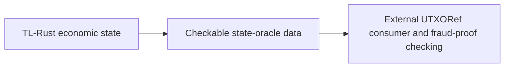

# TL state-oracle producer and external consumer

The user clarified the integration boundary on 26 October 2026:

UTXORef is a separate repository and runtime. TL produces the data on which
its external fraud-proof checks operate. Building the external proof engine is
not a TL-Rust completion requirement. TL does not use Binohash. An optional
Binohash feature belongs in UTXORef, where the user separately authorized it;
there is no Binohash export, dependency, fixture or default runtime path in this
crate. The old experimental Binohash inventory row remains an external
reference, excluded from TL module parity counts.

The existing `state_oracle` functions preserve the pinned legacy query and
serialization semantics. Their source-compatible balance projections alone
do not provide a complete proof-checkable economic state. `EconomicState`
already supplies bounded, canonical full snapshots of its sole Ledger and
economic journals; `EconomicChain` supplies network, genesis and exact tip;
`DurableEconomicChain` supplies a healthy locked owner and independent freshness
head. A production producer export must bind those actual owner bytes and
identities in an explicit versioned contract and preserve exact amounts.
This export integration remains a separate gate; source query parity does not
prove it complete.

Legacy BitVM artifact/cache/risk adapters characterize the JavaScript helpers
and their optional interoperability metadata. The source's historical default
artifact path names an external UTXORef checkout. It is not a bundled runtime,
required local checkout or economic execution dependency. Those helpers do not
verify a fraud proof or confer authority on an externally supplied state root.

An external consumer must independently establish its expected producer identity,
network/genesis/tip and trusted commitments. A self-hash or matching metadata
does not establish a valid chain, correct transition or permission to change
TradeLayer balances. Optional external commitment schemes must not change the
TL export contract without explicit versioning.
